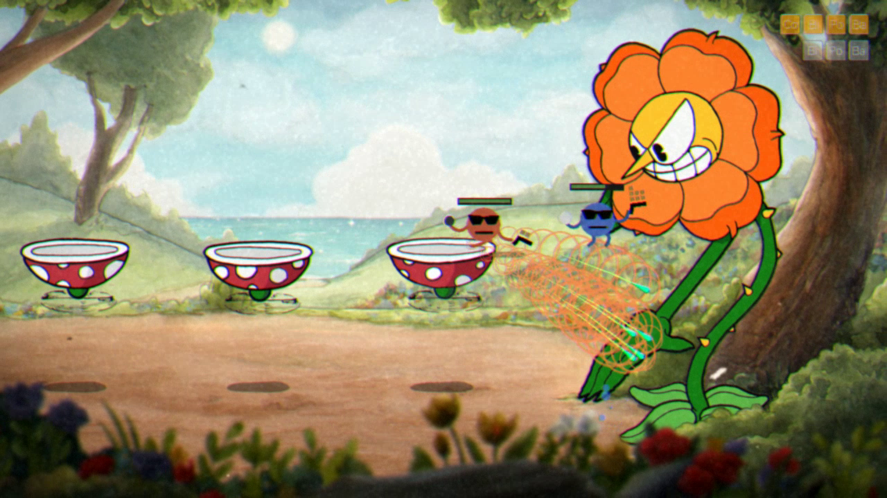

# Roundhead (ROUNDS x Cuphead)

Play Cuphead's whole campaign as your ROUNDS blob.



**Play it on Melty:** [melty.gg/m/roundhead](https://melty.gg/m/roundhead). One click, using your own Steam copies of Cuphead and ROUNDS. The trailer is on that page; a smaller preview is in [media/listing](media/listing/roundhead-trailer-preview.mp4).

## What you get

- **Real ROUNDS players in Cuphead.** On every ground level (bosses, run-and-gun levels, mausoleums) ROUNDS itself runs your player: a hidden copy of your own ROUNDS plays its sandbox with Cuphead's level copied in every frame (floors, platforms, walls, the boss's hit areas), and its picture is drawn into Cuphead. Movement, the gun, bullets, the block, health, death and every card effect are ROUNDS's own code, so cards change your bullets exactly as in ROUNDS, and card mods work with their own code.
- **Every card works on Cuphead's enemies.** What a card does to a ROUNDS opponent it does to Cuphead's bosses and minions, with ROUNDS's own numbers: poison, Parasite and Toxic Cloud tick damage over time (tinted the card's colour); Cold Bullets, Frost Slam, Chilling Presence, Static Field, EMP and Supernova slow enemies (their animations and attack timers run slower, up to ROUNDS's 90% cap); Dazzle and Supernova stun them; Silence and Discombobulate make their shots harmless duds; explosions, saws, Radiance, Shockwave, Overpower and Shield Charge hit everything in range; homing, bounce, Remote and Target Bounce bullets steer at enemies; knockback, Implode and Tractor Beam shove small enemies (bosses flinch instead); lifesteal and on-hit cards (Leech, Taste of Blood, Brawler, Lifestealer...) pay out on enemy damage. Card mods too: King Midas turns enemies gold, Murder skips a boss phase at your next level, Laser burns what it crosses. Bosses shrug statuses off during their phase changes.
- **ROUNDS's own screens.** Card picks are ROUNDS's pick screen (its cards, your face, its rarity and duplicate rules); ROUNDS's health bar sits above each player and its card bar shows your deck.
- **Cuphead's world.** Cuphead's levels, bosses, attacks, story, world map and shop stay Cuphead's. A Cuphead hit takes ROUNDS health (a third of a fresh player's 100), the ROUNDS block stops hits and parries pink things (a parry that lands refills the block and bounces you up, as in Cuphead), and falling off the bottom bounces you back up with a hit, ROUNDS style. You never see Cuphead or Mugman: dying is ROUNDS's burst, and with two players a see-through ROUNDS ghost floats up in a pink ring for your partner to parry.
- **ROUNDS's loop: the loser picks.** Every level is a match. You start it with the plain ROUNDS gun; every time it beats you, each player picks a card on the game-over card (1 of 5, ROUNDS's rules), and the deck comes back with you on Retry or from the map. Beat the level and the deck is gone: the next one starts plain again. King Dice's board is one match (mini bosses keep the deck; King Dice himself wipes). Porkrind sells a card pack for 2 coins: one card into your deck now, a head start on the next attempt.
- **Your own faces.** The launcher's FACES button opens a face editor made of ROUNDS's own parts: give each player the eyes, mouth and two details of your choice from every part ROUNDS has and drag them into place on the face, or start from one of your eight ROUNDS faces. The faces show in their colours on your ROUNDS players in levels, on the pick screen and on the world map; your saved ROUNDS faces stay as they are. The pictures come from your own ROUNDS, which the launcher starts hidden for a few seconds the first time (and again when your ROUNDS faces change).
- **Thunderstore card mods.** The Roundhead launcher browses ROUNDS mods on Thunderstore (card mods first), installs them with their dependencies into Roundhead's own ROUNDS profile, turns them on and off, updates them, and can copy an r2modman / Thunderstore Mod Manager profile or a profile code. Their cards show up in your picks.
- **Two players on one PC, drop in any time.** Player 2 joins the moment they press a button on their controller, on the map or in a level, with no prompt pausing the game: both players are ROUNDS players (orange and blue) with their own cards, sharing one screen. There is no online play.
- **Straight into the game.** One save slot: Start on the title goes right into it. No storybook cutscenes: a new game starts on the world map, and the Devil's offer, King Dice's welcome, the world intros and the ending go straight to what follows them.
- **ROUNDS sounds.** Shots, hits, blocks, deaths, card effects and the pick screen sound like ROUNDS, at Cuphead's sound-effects volume; the music stays Cuphead's.
- **Plane levels too.** You fly Cuphead's plane (its movement, shrink and parry) as your real ROUNDS player: the ROUNDS gun, bullets, block, health and cards replace the plane's shots and super, and the loop is the same (pick on a loss, wiped on a win). A parry that lands refills the block.

Requires your own Cuphead and ROUNDS (the mod-compatible "old-rounds-for-mods" branch Thunderstore supports), both on Steam. Roundhead plays Cuphead's save slot 1 (slots 2 and 3 are left as they are); its cards are saved beside it in `%LOCALAPPDATA%\CupRounds\saves`, never inside Cuphead's save.

## Controls

Player 1 has ROUNDS's keyboard and mouse layout; gamepads work for both players.

| | Keyboard + mouse | Gamepad |
|---|---|---|
| Move | A / D (or Cuphead's keys) | left stick |
| Jump | W or Space (hold for higher) | Cuphead's Jump |
| Drop through a platform | S + jump | down + Jump |
| Aim | mouse (crosshair) | right stick |
| Shoot | left mouse (ROUNDS guns fire per click unless cards make them fast) | right trigger or Shoot |
| Block / parry | right mouse, Cuphead's Dash or EX | left trigger, Dash or EX |
| In plane levels | WASD fly, Space parries, Dash or Lock shrinks, right mouse or EX blocks | as in Cuphead; EX blocks |
| Card pick | A / D or the mouse, Space or click to take | left / right, Jump |
| World map and menus | WASD, Space | as in Cuphead |
| Card pack (shop) | P | Lock |

## How it works

- `CupRoundsLauncher.exe`: the launcher Melty starts (Thunderstore browser, the FACES editor, Play). Your faces are kept in `%LOCALAPPDATA%\CupRounds\faces.txt`, the editor's pictures in `%LOCALAPPDATA%\CupRounds\faces`.
- `cuphead/BepInEx/plugins/CupRounds/CupRounds.Cuphead.dll`: BepInEx plugin for Cuphead (sends the level and input to ROUNDS, draws ROUNDS's picture, card picks and saves).
- `rounds/BepInEx/plugins/CupRounds.CardEngine/CupRounds.CardEngine.dll`: BepInEx plugin for ROUNDS (runs ROUNDS's sandbox with Cuphead's level, the players and the pick screen), talking to Cuphead over shared memory and localhost.
- Nothing from either game is copied: each player's own ROUNDS supplies the cards and look while it runs.

## Building from source

You need Windows, the .NET SDK (8 works; the projects target net35, net472 and net48), Python 3, Git Bash for the dev scripts, and your own Cuphead and ROUNDS on Steam. Nothing from either game is in this repository, and nothing should be added.

1. Unpack BepInEx 5.4.23.2 (`BepInEx_win_x64_5.4.23.2.zip` from the BepInEx GitHub releases) into `~/cuprounds-work/dl/bepinex`. A different work folder can be set with `CUPROUNDS_WORK`.
2. Put the license texts the package ships into `~/cuprounds-work/dl`. The BepInEx download contains none of them, so take each from its project's repository:

   | File | From |
   |---|---|
   | `BepInEx-LICENSE.txt` | github.com/BepInEx/BepInEx, `LICENSE` (MIT) |
   | `UnityDoorstop-LICENSE.txt` | github.com/NeighTools/UnityDoorstop, `LICENSE` (LGPL-2.1) |
   | `HarmonyX-LICENSE.txt` | github.com/BepInEx/HarmonyX, `LICENSE` (MIT) |
   | `MonoMod-LICENSE.txt` | github.com/MonoMod/MonoMod, `LICENSE` (MIT) |
   | `Mono.Cecil-LICENSE.txt` | github.com/jbevain/cecil, `LICENSE.txt` (MIT) |

   The first two are required. The packager warns about the last three when they are missing.
3. If your games are not in `D:\SteamLibrary\steamapps\common`, give their folders to the build as the `CupheadDir` and `RoundsDir` environment variables. In PowerShell that is `$env:CupheadDir = 'E:\Steam\steamapps\common\Cuphead'`, and in Git Bash `export CupheadDir='E:\Steam\steamapps\common\Cuphead'`. The dev scripts set both from `CUPHEAD_DIR` and `ROUNDS_DIR`. ROUNDS must be on the `old-rounds-for-mods` branch.
4. Decompile your own copies once, for the preflight's hook checks. Install the decompiler with `dotnet tool install -g ilspycmd`, then run it on each game's `Assembly-CSharp.dll`:

   ```
   ilspycmd -p -o ~/cuprounds-decomp/cuphead "<Cuphead>/Cuphead_Data/Managed/Assembly-CSharp.dll"
   ilspycmd -p -o ~/cuprounds-decomp/rounds "<ROUNDS>/Rounds_Data/Managed/Assembly-CSharp.dll"
   ```

   This decompiled code is for checking on your machine only. Never commit it.
5. The design sheets in `sheets/` are the source of truth, and `src/Shared/Generated` is made from them. Run `python -I tools/sheets.py gen` after editing a sheet, and `python -I tools/sheets.py preflight --code` before every build. It must print `clean`.
6. `python -I tools/package.py 0.1.6` runs the preflight, builds all three projects and writes `dist/Roundhead-0.1.6.zip`, the package Melty installs.
7. To release it, attach that zip to a GitHub release tagged with the version (`v0.1.6`). `melty.json` at the repository root is the Melty install recipe; it names the package `Roundhead-*.zip`, so Melty takes the tested zip from each release instead of building from source, which needs your own games.
8. To play the staged build without Melty, copy `dist/stage/proxy-cuphead/version.dll` into your Cuphead folder and `dist/stage/proxy-rounds/version.dll` into your ROUNDS folder, then start `dist/stage/managed/CupRoundsLauncher.exe`. Remove the two `version.dll` files afterwards. `devtools/devloader.sh` does the copying for the dev install.

`NOTES.md` holds the design and testing notes. [devtools](devtools/README.md) has the scripts that run the mod on the real games with test bots and that filmed the listing media.

## Credits and license

Roundhead is MIT licensed. Its package bundles BepInEx 5.4.23.2 (MIT, with HarmonyX, MonoMod and Mono.Cecil, all MIT) and UnityDoorstop 4.3.0 (LGPL-2.1, shipped unmodified as `version.dll`). Neither is in this repository; their licenses go in the package's `third-party-notices` folder. Cuphead and ROUNDS are not included: Cuphead is by Studio MDHR Entertainment Inc., ROUNDS is by Landfall Games, and the mod needs your own copies of both. Card mods are by their Thunderstore authors. Made with AI assistance (Claude) for Melty.
